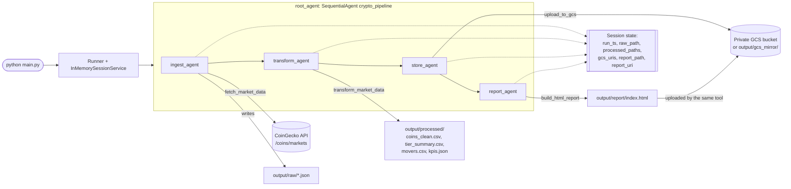

# Agentic crypto data pipeline (Google ADK + GCS)

This project is an end-to-end data engineering pipeline run by AI agents built with Google's Agent Development Kit (ADK). It ingests a market snapshot of the top 100 cryptocurrencies from the CoinGecko public API, cleans and aggregates it with pandas, stores the raw and processed files in a private Google Cloud Storage bucket, and builds a self-contained HTML report that works offline on any phone, tablet or desktop. Four Gemini-powered agents run the steps in order. Each agent calls exactly one Python tool, and the data itself never passes through the LLM: tools share only file paths and small status values through ADK session state.

## Architecture



| Agent | Tool | Reads from state | Writes to state |
|---|---|---|---|
| `ingest_agent` | `fetch_market_data()` | (nothing) | `run_ts`, `raw_path` |
| `transform_agent` | `transform_market_data()` | `raw_path` | `processed_paths` |
| `store_agent` | `upload_to_gcs()` | `run_ts`, `raw_path`, `processed_paths` | `gcs_uris` |
| `report_agent` | `build_html_report()` | `run_ts`, `processed_paths` | `report_path`, `report_uri` |

Each agent also saves its one-line summary in state (`ingest_summary`, `transform_summary`, and so on). Every tool returns a dictionary like `{"status": "success", "rows": 100, "path": "..."}` or `{"status": "error", "error_message": "..."}`. If a step fails, its agent replies with `ERROR: ...`, later tools skip their work, and `main.py` exits with a non-zero code after checking session state.

```
.
├── main.py                     # entry point: python main.py [--local-only]
├── pipeline/
│   ├── agent.py                # root_agent (SequentialAgent) + 4 LlmAgents
│   ├── config.py               # loads and validates .env, masks secrets
│   ├── tools/                  # ingest.py, transform.py, storage.py, report.py
│   └── templates/report.html.j2
├── tests/                      # pytest suite + small made-up fixture
├── docs/                       # Future Improvements source + build_docx.py (the .docx is submitted separately)
├── .env.example                # placeholders only
├── requirements.txt            # pinned runtime dependencies
└── requirements-dev.txt        # + pytest, python-docx
```

## Prerequisites

- **Python 3.10 or newer** (tested on 3.13)
- **A Google AI Studio API key** for Gemini: create one at <https://aistudio.google.com/apikey>
- **The gcloud CLI**: <https://cloud.google.com/sdk/docs/install> (not needed for `--local-only`)
- **A Google Cloud project with a private bucket** (created below; not needed for `--local-only`)
- *Optional:* a free CoinGecko Demo API key. The pipeline makes one request per run, which works without a key.

## Setup

### 1. Get the code and install dependencies

macOS / Linux (bash or zsh):

```bash
git clone https://github.com/beluga121/agentic-crypto-pipeline.git
cd agentic-crypto-pipeline
python3 -m venv .venv
source .venv/bin/activate
pip install -r requirements.txt
cp .env.example .env
```

Windows (PowerShell):

```powershell
git clone https://github.com/beluga121/agentic-crypto-pipeline.git
cd agentic-crypto-pipeline
py -m venv .venv
.\.venv\Scripts\Activate.ps1
pip install -r requirements.txt
copy .env.example .env
```

If PowerShell blocks the activation script, run `Set-ExecutionPolicy -Scope CurrentUser RemoteSigned` once, then activate again.

### 2. Fill in `.env`

Open `.env` in a text editor and set at least:

```
GOOGLE_API_KEY=<your AI Studio key>
GCS_BUCKET=<your bucket name>
```

`GEMINI_MODEL` defaults to `gemini-3.8-flash`. `COINGECKO_API_KEY` and `GOOGLE_CLOUD_PROJECT` are optional.

### 3. Create the private bucket and log in (skip for `--local-only`)

These commands are the same in bash and PowerShell. Replace the placeholders.

```bash
gcloud auth login
gcloud config set project YOUR_PROJECT_ID

# Private bucket: uniform bucket-level access + public access prevention enforced
gcloud storage buckets create gs://YOUR_BUCKET_NAME --location=us-central1 --uniform-bucket-level-access --public-access-prevention

# Least privilege: let your account create objects in this one bucket only
gcloud storage buckets add-iam-policy-binding gs://YOUR_BUCKET_NAME --member=user:YOUR_EMAIL --role=roles/storage.objectCreator

# Application Default Credentials, used by the google-cloud-storage library
gcloud auth application-default login
gcloud auth application-default set-quota-project YOUR_PROJECT_ID
```

Bucket names must be globally unique: 3–63 lowercase letters, digits, dashes or underscores. The code never creates buckets and never changes access settings.

## How to run

```bash
python main.py               # full run: uploads to your private GCS bucket
python main.py --local-only  # no GCP needed: writes the bucket layout to output/gcs_mirror/
```

You can also set `STORAGE_MODE=local` in `.env` instead of passing `--local-only`.

Console output looks like this (your numbers will differ):

```
Crypto data pipeline | model: gemini-3.8-flash | storage: gcs

[1/4] ingest_agent
      -> calling tool fetch_market_data()
      Fetched 100 coins and saved the raw data to output/raw/coingecko_markets_20261117T153513Z.json.

[2/4] transform_agent
      -> calling tool transform_market_data()
      Kept 81 coins, excluded 19 stablecoins, and wrote 4 processed files.

[3/4] store_agent
      -> calling tool upload_to_gcs()
      Stored 5 files in gcs mode.

[4/4] report_agent
      -> calling tool build_html_report()
      Built the report at output/report/index.html and stored it at gs://your-bucket/reports/dt=2026-11-17/20261117T153513Z/index.html.

Pipeline finished.
  Stored files:  6 (gcs mode)
  Report stored: gs://your-bucket/reports/dt=2026-11-17/20261117T153513Z/index.html
  Open locally:  /full/path/to/output/report/index.html
```

Open the printed `index.html` path in any browser. The page needs no internet connection.

### Where the outputs go

Locally:

| Path | Contents |
|---|---|
| `output/raw/coingecko_markets_<run_ts>.json` | The API response, byte for byte |
| `output/processed/coins_clean.csv` | One row per coin after cleaning, filtering and enrichment |
| `output/processed/tier_summary.csv` | Aggregates per market-cap tier |
| `output/processed/movers.csv` | Top 10 gainers and top 10 losers |
| `output/processed/kpis.json` | Headline numbers |
| `output/report/index.html` | The report |
| `output/gcs_mirror/...` | Bucket layout copy (`--local-only` only) |

In GCS (`<run_ts>` looks like `20261117T153513Z`):

```
gs://YOUR_BUCKET/raw/coingecko/markets/dt=2026-11-17/<run_ts>.json
gs://YOUR_BUCKET/processed/coingecko/markets/dt=2026-11-17/<run_ts>/coins_clean.csv   (+ tier_summary.csv, movers.csv, kpis.json)
gs://YOUR_BUCKET/reports/dt=2026-11-17/<run_ts>/index.html
```

The `dt=` folders are Hive-style partitions, so BigQuery or Spark can later read only the dates they need. To download the report from GCS: `gcloud storage cp gs://YOUR_BUCKET/reports/dt=.../index.html .`

### Optional: the ADK web UI

`root_agent` is exposed in `pipeline/agent.py`, so ADK's developer UI also works. From the project root, run `adk web` and pick `pipeline`. `python main.py` remains the supported way to run the pipeline, because it also validates the configuration and checks every step's output.

## Transformations and why they matter

All transformations live in `pipeline/tools/transform.py` as small pure functions with unit tests.

1. **Clean.** Keep the needed columns, convert numbers safely (bad values become empty instead of crashing), and drop coins with no price or a market cap of zero. API data is treated as untrusted, and every later step depends on price and market cap.
2. **Filter out stablecoins.** Stablecoins such as USDT and USDC are pegged to $1, so their "price change" is noise, and their large market caps would distort tier shares and the market-wide average. A coin is removed if it is on a short, documented list of known stablecoins, **or** if it trades between $0.98 and $1.02 and moved less than ±0.5% in 24 hours. The rule catches new stablecoins that are not on the list yet. In a test run it removed 19 coins, all of them genuine dollar-pegged tokens.
3. **Derive.** `volume_to_mcap_ratio` (24h volume ÷ market cap) is a liquidity signal: a high value means a coin trades a lot relative to its size. `market_cap_tier` buckets coins into **Mega** (≥ $100B), **Large** ($10B–100B), **Mid** ($1B–10B) and **Small** (< $1B).
4. **Group and aggregate by tier.** Coin count, total market cap, share of total market cap, median and mean 24h change, and total volume per tier. This shows how concentrated the market is (two Mega coins usually hold most of the value) and whether small caps move differently from large caps. The median is shown next to the mean because a single outlier can skew the mean.
5. **Rank movers.** The top 10 gainers (24h change > 0) and top 10 losers (24h change < 0). Requiring the sign means a coin that rose is never listed as a "loser", even on a day when the whole market is up.
6. **KPIs.** Total market cap, total 24h volume, coins up vs. down, and the **market-cap-weighted** 24h change. The weighted average reflects how the market as a whole moved, because Bitcoin counts far more than a tiny coin.

## The report page

`output/report/index.html` is styled in an IBM Design Language / Carbon-inspired system: gray-dominant neutrals with one purple accent, the 2x Grid (4 / 8 / 16 columns, 8px spacing unit), the IBM type scale, and flat, square tiles. It follows the system's dark theme automatically through `prefers-color-scheme`. It uses IBM Plex fonts if they are installed and falls back to Helvetica or Arial otherwise.

- KPI row, a market-cap-share-by-tier bar chart, top 10 gainers and losers charts, and a tier summary table
- Charts are inline SVG generated from Python-computed geometry. Bar widths are percentages, so charts stretch to any screen while the text stays readable.
- Gains and losses show a `+` or `−` sign and an arrow, so the meaning never depends on color alone.
- On narrow screens the layout stacks into one column and the table scrolls sideways inside its tile.
- Fully self-contained: no JavaScript, web fonts, images or CDN calls. A strict Content-Security-Policy (`default-src 'none'`) enforces this.

## Tests

```bash
pip install -r requirements-dev.txt
pytest
```

The tests use a small made-up fixture (`tests/fixtures/sample_markets.json`) and never call CoinGecko, Gemini or GCS. They cover each transformation, number formatting, chart geometry, the self-contained page rules, and a hostile coin name (`<script>alert(1)</script>`) that must come out escaped.

## Security notes

- **Secrets stay out of git.** Real values live in `.env`, which is git-ignored. Only `.env.example` with placeholders is committed. `.gitignore` also covers `output/`, key and credential JSON files, `.venv/`, `__pycache__/` and `.adk/`.
- **No key files.** GCS uses Application Default Credentials from `gcloud auth application-default login`. There are no service-account key files in this repository.
- **Nothing secret is printed.** Every console message passes through a masking function, and the CoinGecko key is only ever sent in a request header.
- **Least privilege.** Grant only **Storage Object Creator** (`roles/storage.objectCreator`) on the one bucket. It can add objects but cannot read, list or delete them, or change the bucket. If you want to browse the files with the same account, use Storage Object Admin instead. Project owners already have more access than this. The role matters most for a dedicated account or a future service account.
- **The bucket stays private.** It is created with uniform bucket-level access and public access prevention enforced, and the code never sets ACLs or makes anything public. The report is meant to be opened locally. Hosting it publicly would expose your storage to anyone, so sharing should go through authenticated access (see the Future Improvements document).
- **API data is untrusted.** Values are type-coerced in pandas, and every string is HTML-escaped by Jinja2 autoescaping. The report never uses `|safe`.
- **Pinned dependencies.** Every direct dependency has an exact version in `requirements.txt`.

## Troubleshooting

| Problem | What to do |
|---|---|
| `GOOGLE_API_KEY is missing` | Create a key at <https://aistudio.google.com/apikey>, put it in `.env`, and make sure you copied `.env.example` to `.env` in the project root. |
| `Gemini rejected the API key` | The key is wrong or was deleted. Create a new one and update `.env`. |
| `Gemini model not found` | Google retires models over time. Set `GEMINI_MODEL` in `.env` to a current Flash model listed at <https://ai.google.dev/gemini-api/docs/models>. |
| `HTTP 429 rate limit` from CoinGecko | Keyless access shares a limit with everyone on your IP address. Wait a minute and retry, or add a free Demo key as `COINGECKO_API_KEY`. The tool already retries 3 times with backoff. |
| `Google Cloud credentials are missing or expired` | Run `gcloud auth application-default login`. |
| `Bucket '...' does not exist` | Check the `GCS_BUCKET` spelling and the project, or create the bucket (step 3). |
| `Permission denied writing to '...'` | Grant your account Storage Object Creator on the bucket (step 3). IAM changes can take a minute to apply. |
| No GCP project at all | Run `python main.py --local-only`. |

## Data attribution

Data provided by [CoinGecko](https://www.coingecko.com/). The report page shows this attribution and a link, as CoinGecko's API terms require.

## License

MIT. See [LICENSE](LICENSE).
